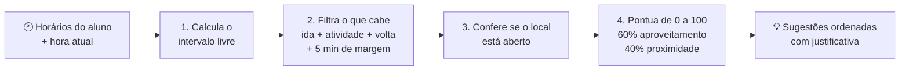
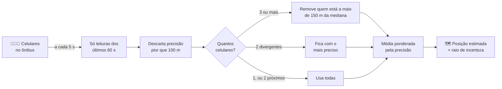
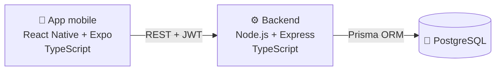

<div align="center">

# 🚌 BUS.AI

### Plataforma de apoio à mobilidade universitária

Use melhor o tempo entre as aulas e saiba onde o seu ônibus está,<br>
com a localização compartilhada pelos próprios estudantes.


**Trabalho de Conclusão de Curso · Sistemas de Informação · UEMG Unidade Passos**

[Funcionalidades](#-funcionalidades) ·
[Como funciona](#-como-funciona) ·
[Arquitetura](#-arquitetura) ·
[Como rodar](#-como-rodar) ·
[Documentação](#-documentação)

</div>

---

## Sobre o projeto

Muitos estudantes da UEMG Passos vêm de outras cidades em ônibus de prefeituras ou de empresas, e a rotina deles
depende de horários que nem sempre se encaixam: intervalos entre aulas, espera pelo ônibus, trajetos longos.

O **BUS.AI** junta duas coisas para apoiar essa rotina:

| | |
|---|---|
| 🕐 **Tempo livre bem aproveitado** | O app identifica o intervalo até o próximo compromisso e sugere atividades que **cabem nele**, já contando o deslocamento a pé. |
| 📍 **Ônibus no mapa sem GPS no ônibus** | Os ônibus não têm rastreador nem API da empresa. A posição é **estimada a partir dos celulares dos alunos** que estão dentro dele e autorizaram o compartilhamento. |

> **Exemplo:** a aula termina às 14:00 e a próxima começa às 15:30. O BUS.AI mostra os 90 minutos livres e sugere,
> por exemplo, estudar na biblioteca, explicando por que a atividade cabe: *"45 min de atividade, 1 min até a
> biblioteca, 1 min até a aula; sobram 38 min"*.

---

## Funcionalidades

| Requisito | O que o estudante faz no app |
|---|---|
| 🔐 **Autenticação e perfil** | Cria a conta, entra e escolhe o ônibus que usa. O login fica salvo com segurança no celular. |
| 📅 **Mobilidade** | Cadastra as aulas da semana e vê os intervalos livres de cada dia. |
| 💡 **Recomendação inteligente** | Vê o tempo livre e as atividades sugeridas, com justificativa. Um modo de simulação permite testar qualquer dia e hora. |
| 📡 **Geolocalização colaborativa** | Toca em **"Estou no ônibus"** e passa a compartilhar a posição durante a viagem. Funciona mesmo com falhas de sinal. |
| 🗺️ **Mapa** | Acompanha a posição estimada do ônibus, com a margem de incerteza e quantos colegas estão compartilhando. |

**Privacidade em primeiro lugar:** a localização só é usada com autorização explícita, apenas durante a viagem e pode
ser desligada a qualquer momento. O mapa mostra só a posição **combinada** do ônibus, nunca a de um aluno.

---

## Como funciona

### Recomendação de atividades

Um sistema **baseado em regras e pontuação**: simples, determinístico, testável e capaz de explicar cada sugestão.



As atividades que não cabem também aparecem, com o motivo (*"precisa de 97 min, há 90 min"*).

### Geolocalização colaborativa

Cada celular dentro do ônibus envia sua posição a cada **5 segundos**. O servidor combina as leituras recentes
e trata as posições inconsistentes antes de estimar onde o ônibus está.



Sem internet na estrada, o app guarda as leituras numa fila e envia tudo quando o sinal volta. Cada leitura carrega
o horário em que foi medida.

---

## Arquitetura



| Camada | Tecnologias |
|---|---|
| **App** | React Native, Expo SDK 58, Expo Router, Expo Location, React Native Maps, Expo Secure Store |
| **Backend** | Node.js, Express 5, Zod (validação), JWT (autenticação), bcrypt (senhas) |
| **Dados** | PostgreSQL, Prisma ORM |
| **Testes** | `node:test` com 28 testes automatizados (recomendação, estimativa de posição e análise dos testes de campo) |

### Estrutura do repositório

```
BUS.ai/
├── 📱 mobile/                 App do estudante
│   └── src/
│       ├── app/               Telas (cada arquivo é uma rota)
│       ├── api/               Comunicação com o backend
│       ├── viagem/            Compartilhamento de localização
│       └── components/        Peças visuais reutilizadas
├── ⚙️ backend/                API REST
│   ├── src/
│   │   ├── routes/            Rotas da API
│   │   ├── recomendacao/      Motor de recomendação + testes
│   │   └── geolocalizacao/    Estimativa de posição e análise + testes
│   ├── prisma/                Modelo do banco, migrações e dados iniciais
│   ├── scripts/               Simulação e análise dos testes de campo
│   └── public/coletor.html    Coletor web (plano B dos testes de campo)
└── 📄 docs/                   Contrato da API e protocolo de avaliação
```

---

## Como rodar

Você vai precisar de **Node.js LTS**, **PostgreSQL** e do app **Expo Go** no celular.

<details>
<summary><b>⚙️ 1. Backend</b></summary>

<br>

Na pasta `backend`:

```bash
npm install                    # instala as dependências
cp .env.example .env           # no Windows: copy .env.example .env
```

Preencha o `.env` com a conexão do PostgreSQL (`DATABASE_URL`) e uma chave secreta (`JWT_SECRET`). Depois:

```bash
npx prisma migrate dev         # cria as tabelas
npx prisma db seed             # cadastra locais, atividades e linhas de ônibus
npm run dev                    # inicia a API em http://localhost:3333
```

Teste no navegador: `http://localhost:3333/health` deve responder `{"status":"ok"}`.

</details>

<details>
<summary><b>🌐 2. Acesso pelo celular (túnel)</b></summary>

<br>

Para o celular acessar o backend de qualquer rede, a equipe usa um túnel da Cloudflare:

```bash
cloudflared tunnel --url http://localhost:3333
```

Anote o endereço `https://...trycloudflare.com`. Ele **muda** toda vez que o túnel é reiniciado.

</details>

<details>
<summary><b>📱 3. App mobile</b></summary>

<br>

Na pasta `mobile`:

```bash
npm install
cp .env.example .env.local     # no Windows: copy .env.example .env.local
```

Coloque o endereço do túnel no `.env.local` (`EXPO_PUBLIC_API_URL=...`) e inicie:

```bash
npx expo start                 # use --tunnel se o celular estiver em outra rede
```

Escaneie o QR code com o Expo Go. Mais detalhes em [`mobile/README.md`](mobile/README.md).

</details>

<details>
<summary><b>🧪 4. Testes automatizados</b></summary>

<br>

Na pasta `backend`:

```bash
npm test
```

Cobrem o cálculo do intervalo livre, a viabilidade e a pontuação das recomendações, a estimativa de posição com
1, 2 e 3 celulares, o tratamento de outliers e as funções de análise dos testes de campo.

</details>

---

## Avaliação

O projeto segue a metodologia **Design Science Research**: construir o artefato e avaliá-lo. A avaliação separa
claramente três tipos de evidência:

| Tipo | O que é | Onde está |
|---|---|---|
| 🧪 **Testes automatizados** | Casos conhecidos com resultado esperado | `backend/src/**/*.test.ts` |
| 💻 **Simulação** | Celulares virtuais enviando posições sintéticas pela API real (5, 10 e 15 s) | `backend/scripts/simular.ts` |
| 🚌 **Teste de campo** | Viagem real com 1, 2 e 3 celulares, comparando com pontos de controle | [`docs/protocolo-teste-campo.md`](docs/protocolo-teste-campo.md) |

Dados simulados e dados de campo **nunca são misturados**.

---

## Limitações conhecidas

- **Coleta no iPhone só com o app aberto:** no Android, o app é instalado como APK e envia a localização com a tela bloqueada; no iPhone, ele roda pelo Expo Go, que só envia com o app na tela (o envio em segundo plano no iPhone exigiria uma conta paga da Apple).
- **Mapa embutido só no iPhone:** no Android, ele exigiria uma chave paga do Google Maps; o painel e o botão "Abrir no app de mapas" continuam funcionando.
- **GPS em lugar fechado:** a precisão pode passar de 100 m, e essas leituras são descartadas.
- **Recomendação por regras:** o sistema não usa aprendizado de máquina; as regras e os pesos estão declarados e podem ser explicados.
- **Backend local:** nos testes, a API roda no computador da equipe e é acessada por um túnel.

---

## Documentação

| Documento | Conteúdo |
|---|---|
| 📄 [`docs/API.md`](docs/API.md) | Todas as rotas da API, com exemplos de requisição e resposta |
| 🚌 [`docs/protocolo-teste-campo.md`](docs/protocolo-teste-campo.md) | Como executar e analisar o teste de campo |
| 📱 [`mobile/README.md`](mobile/README.md) | Detalhes do app: telas, parâmetros e limitações |

---

<div align="center">

### Equipe

**Kauan Alexandre Dias Silva** · **João Victor Miranda Oliveira**

Orientação: **Prof.º Luiz Fernando Moura Piantino** -
Coorientação: **Prof.ª Vania Borges**

Universidade do Estado de Minas Gerais · Unidade Passos · 2026

</div>
